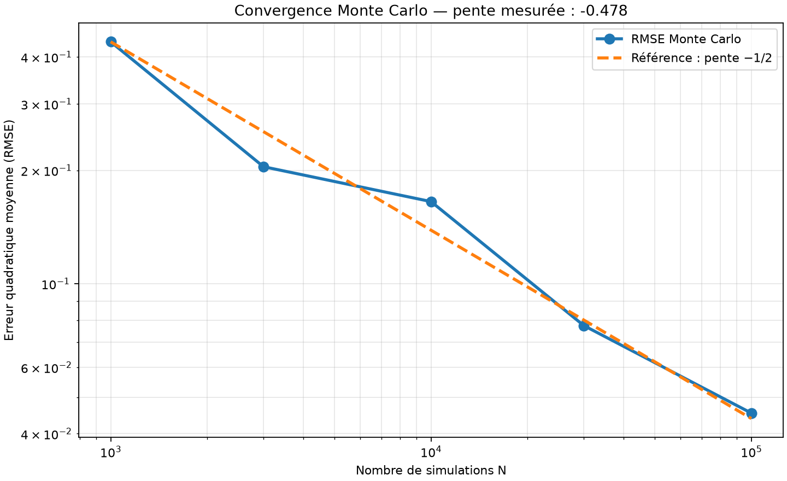
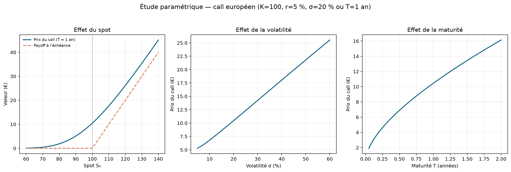

# Pricing d’options européennes

Ce projet compare le prix analytique de Black–Scholes à une estimation par Monte Carlo pour des options européennes sans dividendes. Il calcule aussi delta, gamma et vega, puis vérifie les sensibilités par différences finies. Une interface PyQt5 permet de modifier les paramètres.

## Modèle et formules

Sous la probabilité risque neutre, le sous-jacent suit un mouvement brownien géométrique :

\[
 dS_t = r S_t\,dt + \sigma S_t\,dW_t^{\mathbb Q}, \qquad
 S_T = S_0\exp\left((r-\tfrac12\sigma^2)T + \sigma\sqrt{T}Z\right),
 \quad Z\sim\mathcal N(0,1).
\]

Le prix est l’espérance risque neutre du payoff actualisé. Pour un call et un put :

\[
 C_0=e^{-rT}\mathbb E^{\mathbb Q}[(S_T-K)^+], \qquad
 P_0=e^{-rT}\mathbb E^{\mathbb Q}[(K-S_T)^+].
\]

Black–Scholes donne une formule fermée. Avec
\[
 d_1=\frac{\ln(S_0/K)+(r+\sigma^2/2)T}{\sigma\sqrt T},
 \qquad d_2=d_1-\sigma\sqrt T,
\]
les prix sont
\[
 C_0=S_0N(d_1)-Ke^{-rT}N(d_2), \qquad
 P_0=Ke^{-rT}N(-d_2)-S_0N(-d_1).
\]
La parité call-put vérifiée par les tests est \(C_0-P_0=S_0-Ke^{-rT}\).

## Méthodes

- **Black–Scholes** : prix fermé du call et du put européens.
- **Monte Carlo** : simulation de \(S_T\), moyenne des payoffs actualisés, erreur standard et intervalle de confiance normal à 95 %.
- **Grecques** : formules fermées pour delta, gamma et vega, comparées à des différences finies centrées sur le prix.
- **Convergence** : RMSE mesurée sur des répétitions indépendantes du pricer Monte Carlo ; régression de \(\log(\mathrm{RMSE})\) en fonction de \(\log(N)\). La pente théorique est \(-1/2\).

## Résultats de référence

Paramètres : \(S_0=100\,€\), \(K=100\,€\), \(r=5\%\), \(\sigma=20\%\), \(T=1\) an. Les taux et la volatilité sont annualisés et exprimés en décimaux dans l’API Python.

| Méthode | Résultat du call |
| --- | ---: |
| Black–Scholes | 10,450584 € |
| Monte Carlo, \(N=1\,000\,000\), seed 2026 | 10,447934 € |
| Erreur standard Monte Carlo | 0,014739 € |
| Intervalle de confiance Monte Carlo à 95 % | [10,419047 € ; 10,476821 €] |
| Écart absolu avec Black–Scholes | 0,002650 € (0,18 erreur standard) |

La valeur analytique est dans l’intervalle de confiance. Les nombres Monte Carlo sont reproductibles avec la seed indiquée :

```bash
PYTHONPATH=src python - <<'PY'
from option_pricing.monte_carlo import monte_carlo_price

result = monte_carlo_price(
    100, 100, 1, 0.05, 0.20,
    option_type="call", n_paths=1_000_000, seed=2026,
)
print(result)
PY
```

La convergence utilise les tailles \(N=(1\,000, 3\,000, 10\,000, 30\,000, 100\,000)\), 30 répétitions par taille et la seed 2026. La pente log-log mesurée par le code est **−0,478**, proche de la valeur théorique **−0,5**.

| Grecque du call | Formule fermée | Différences finies | Écart absolu |
| --- | ---: | ---: | ---: |
| Delta | 0,636831 | 0,636745 | 8,60 × 10⁻⁵ |
| Gamma | 0,018762 | 0,018760 | 2,30 × 10⁻⁶ |
| Vega (par variation de 1,00 de σ) | 37,524035 | 37,524034 | 3,05 × 10⁻⁷ |

### Convergence Monte Carlo



### Étude paramétrique

Le graphique compare le prix avant échéance au payoff du call à l’échéance selon le spot, puis montre l’effet de la volatilité et de la maturité.



## Installation et lancement

Avec Python 3.10 ou plus récent, depuis la racine du dépôt :

```bash
python -m venv .venv
source .venv/bin/activate          # macOS / Linux
python -m pip install -r requirements.txt
PYTHONPATH=src python -m option_pricing.gui
```

Sur Windows PowerShell, active l’environnement avec `.\.venv\Scripts\Activate.ps1`, puis définis `PYTHONPATH` avec `$env:PYTHONPATH="src"` avant de lancer `python -m option_pricing.gui`.

Pour lancer les tests :

```bash
PYTHONPATH=src python -m pytest
```

Le lanceur `run_pricer.command` ouvre l’interface par double-clic sur **macOS uniquement**. La commande Python ci-dessus est l’alternative pour les autres systèmes.

## Limites et état du projet

Le modèle suppose une volatilité constante, un taux sans risque constant, l’absence de dividendes et une option européenne exercée uniquement à l’échéance. Les options américaines et les modèles à volatilité locale ou stochastique ne sont pas couverts.

**Déjà implémenté :** Black–Scholes, Monte Carlo avec intervalle de confiance, convergence, grecques, différences finies, étude paramétrique et interface PyQt5. Les tests couvrent notamment les prix de référence, la parité call-put, l’accord Monte Carlo/Black–Scholes et la comparaison des grecques.

**À compléter :** notebook d’analyse, réduction de variance (au moins variables antithétiques), option asiatique et ligne de CV. Aucune licence open source n’a encore été choisie.

Projet développé avec assistance IA.
